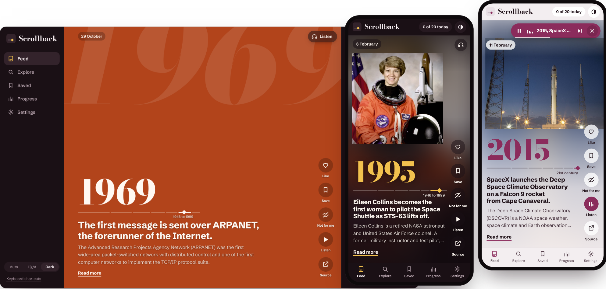
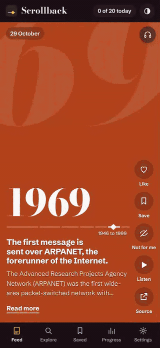
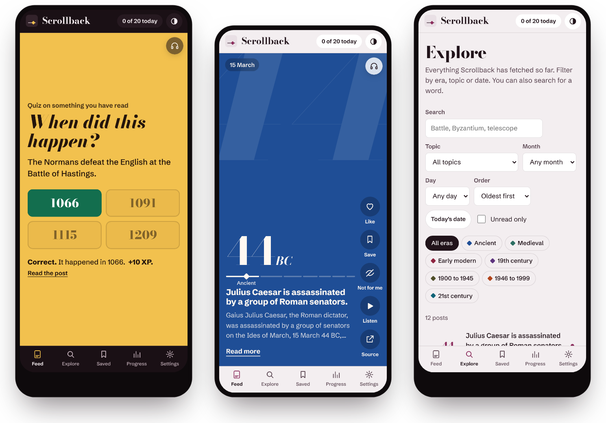
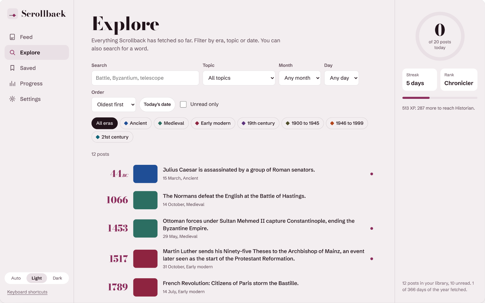
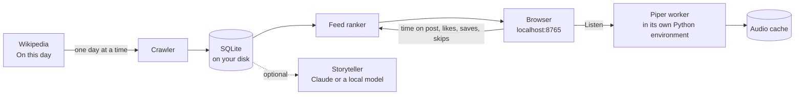

<p align="center">
  
</p>

<h1 align="center">Scrollback</h1>

<p align="center">
  <b>Scroll back through history, one full-screen post at a time.</b><br>
  <b>Real events from Wikipedia, in a feed that runs on your own computer.</b><br>
  Written in Python with no dependencies. It reads posts aloud with a voice that runs on your machine.
</p>

<p align="center">
  <a href="https://github.com/ppolydoras/scrollback/actions/workflows/tests.yml"></a>
  <a href="https://github.com/ppolydoras/scrollback/releases/latest"></a>
  <a href="https://github.com/ppolydoras/scrollback/stargazers"></a>
  <a href="LICENSE"></a>
  <br>
  
  
  
  
  <br>
  <a href="#listen-instead-of-reading"></a>
  <a href="#configuration"></a>
  <a href="#install"></a>
  <a href="#with-docker"></a>
</p>

<p align="center">
  <a href="https://ppolydoras.github.io/scrollback/"></a>
  <a href="#install"></a>
</p>

<p align="center">
  
</p>

Scrollback is shaped like a social media app. Full-screen posts that never run out, a like button, a daily streak. The difference is what's in the posts: every one is a real event from history, taken from Wikipedia's "On this day" pages. It runs on your own computer for one person. It learns which periods and subjects you stay on, quizzes you on what you read and reads posts aloud with a voice that runs on your laptop.

**[Try the browser demo](https://ppolydoras.github.io/scrollback/)** before you install anything. It has a few hundred events, with this week's "On this day" posts, and keeps your likes and progress in your browser. It is rebuilt from Wikipedia every Monday.

## What it looks like



Each post takes the whole screen. The year is set large in Bodoni, with a small timeline under it that shows where the year falls between the ancient world and today. The Wikipedia summary and the opening of the article sit at the bottom. Like, Save, Not for me, Listen and Source sit in a column on the right.

The recording on the right shows, in order:

1. scrolling from 1969 to 44 BC
2. a double-click on the picture to like the post
3. a quiz on an event read earlier, answered correctly
4. switching to the light theme with the T key
5. turning on hands-free listening

Posts with a picture use the picture from the Wikipedia article. If the picture's shape is far from the screen's shape, Scrollback shows all of it over a blurred copy, so portraits and maps are not cut.

Posts without a picture get the colour of their era (see the table below) with the year printed very large behind them.

<br clear="right">

## Install

You need Python 3.10 or newer, which Ubuntu has shipped since 22.04. Scrollback uses only the Python standard library: no pip packages, no Node, no build step.

```bash
git clone https://github.com/ppolydoras/scrollback.git
cd scrollback
python3 scrollback.py --open
```

Your browser opens http://localhost:8765. The first posts appear within a few seconds. Scrollback then fetches the rest of the year in the background, one day at a time, which takes about half an hour. After that it has every event Wikipedia lists for all 366 days.

To run it as a desktop app on Ubuntu, with a launcher in the app grid and a service that starts at login:

```bash
./scripts/install.sh
```

The launcher opens Scrollback in its own window when Chrome or Chromium is installed. Use `./scripts/install.sh --no-service` if you would rather start it only when you open it. Use `SCROLLBACK_PORT=9000 ./scripts/install.sh` for another port.

### With Docker

The image includes Piper, so you only need to pick a voice under Settings. It is built for amd64 and arm64, which covers a Raspberry Pi 4 or 5.

```bash
docker run -d --name scrollback --restart unless-stopped \
  -p 127.0.0.1:8765:8765 -v scrollback:/data \
  ghcr.io/ppolydoras/scrollback
```

Then open http://localhost:8765. Your history and voices live in the `scrollback` volume. There is also a [compose.yaml](compose.yaml).

To use it from other devices on your network, publish the port without `127.0.0.1:` and list the names you reach the server by, such as `-e SCROLLBACK_ALLOWED_HOSTS=homeserver.local`. Scrollback has no login, so do this only on a network you trust.

## Listen instead of reading

```bash
./scripts/setup-tts.sh
```

This puts [Piper](https://github.com/OHF-Voice/piper1-gpl) in a private Python environment in `~/.local/share/scrollback` and downloads a British English voice of about 60 MB. Speech is made on your computer. No text is sent anywhere to be read aloud.

Press **Listen** on a post to hear it. Press **Listen** at the top of the feed (or H) for hands-free mode: Scrollback reads a post, waits a moment and moves on to the next one. Scroll to another post and it reads that one instead. While a post is being read its picture zooms slowly, as in a history documentary. The play, pause and next keys on your keyboard work. So does the sound menu in the Ubuntu top bar.

Before Piper sees the text, Scrollback rewrites years and dates the way people say them. 1805 becomes "eighteen oh five" and 21 October becomes "the twenty-first of October". Without this, Piper says "one thousand eight hundred and five".

You can pick the voice and the speaking speed in Settings, play a sample and download other voices. Two other good British voices are `en_GB-alan-medium` and `en_GB-northern_english_male-medium`.

## Each era has its own colour

Posts without a picture take the colour of a pigment or dye from their period.

| | Era | Colour | Why this colour |
|---|---|---|---|
|  | Ancient, up to AD 499 | Egyptian blue | Considered the first synthetic pigment. It was made in Egypt from the Fourth Dynasty. |
|  | Medieval, 500 to 1499 | Verdigris | A copper green that medieval painters used widely. |
|  | Early modern, 1500 to 1799 | Madder lake | A red made from madder root, common on Renaissance and Baroque palettes. |
|  | 19th century | Mauveine | The first synthetic dye, discovered by William Perkin in 1856. |
|  | 1900 to 1945 | Olive drab | The colour of US Army uniforms and vehicles in both World Wars. |
|  | 1946 to 1999 | International orange | The Space Shuttle launch suit from 1994 and the Golden Gate Bridge. |
|  | 21st century | Teal | The light of a screen at night. |

<p align="center">
  
</p>

## What else it does

**A feed that learns.** Time spent on a post counts. So do likes, saves, "Not for me" and quick skips. Each one moves the post's era and topics up or down. The next posts are scored on those preferences, with extra weight for events on today's date. One pick in eight is random, so the feed keeps showing you periods you have not tried. The Progress page shows what it has learned.

**Quizzes on what you read.** Every few posts you get a question about an event you have already seen: when it happened or which of two events came first. A wrong answer comes back after 20 minutes. A right answer comes back after 1 day, then 3, 7, 16, 35 and 90.

**A daily goal and a streak.** 20 posts a day by default. XP for reading and for quiz answers, with seven ranks from Novice to Oracle.

**Explore.** Everything fetched so far, filtered by era, topic, month, day or a search word. Sort it oldest first and you can read history in order.

**Light and dark themes.** It follows your system setting. You can also choose one in the side bar or press T.

<p align="center">
  
</p>

**An optional storyteller.** A language model can rewrite upcoming posts into short stories and write extra quiz questions. It gets only the Wikipedia text for each post and is told not to add facts. The original text is always one click away. It works with the Anthropic API or any OpenAI-compatible server, such as Ollama on your own machine. It is off by default.

## Keyboard

| Key | Action |
|---|---|
| J or ↓ | Next post |
| K or ↑ | Previous post |
| L | Like (or double-click the picture) |
| S | Save |
| X | Not for me |
| P | Listen to this post. Press again to pause |
| H | Hands-free listening on or off |
| Enter | Read the full post with linked articles |
| O | Open the Wikipedia article |
| 1 to 4 | Answer a quiz |
| T | Switch between light and dark |
| ? | Show all shortcuts |

## How it works



The server is a single Python process with no dependencies. It serves the page and a small JSON API on 127.0.0.1. The crawler calls the Wikifeeds `onthisday` endpoint once for each day of the year, waits between calls and refreshes each day every six months. Events get an era from their year and up to three topics from keyword rules, without any model.

Piper runs in a separate process inside its own virtual environment. Scrollback sends it one JSON line per post and gets back a WAV file, which is cached. The worker starts the first time you listen and stops after ten idle minutes to free memory.

The front end is one HTML file, one stylesheet and one script, with no framework. The whole project is about 5,600 lines, plus 700 lines of tests.

## Privacy

- The server listens on 127.0.0.1 only, unless you change that. Nothing else on your network can reach it.
- It answers only requests addressed to `localhost` (or names you add with `SCROLLBACK_ALLOWED_HOSTS`), which blocks DNS rebinding attacks from websites.
- There are no accounts, no analytics and no tracking. Your reading history is a SQLite file in `~/.local/share/scrollback`.
- Scrollback contacts Wikipedia for text and your browser loads pictures from Wikimedia. Hugging Face is contacted only when you download a voice. A model provider is contacted only if you turn on the storyteller.
- Requests that change data need a custom header, so other websites open in your browser cannot send them.
- The browser demo runs entirely in your browser. GitHub Pages serves its files and Wikimedia serves the pictures. Nothing you do there is sent anywhere.

## Configuration

Most settings are on the Settings page: theme, voice, speaking speed, daily goal, how often quizzes appear, the Wikipedia language and whether to include births and deaths of notable people.

The storyteller and a few other options can also be set with environment variables. When Scrollback runs as a service, put them in `~/.config/scrollback/env` (the installer creates it, readable only by you) and restart with `systemctl --user restart scrollback`. A service does not see variables from your shell profile.

```bash
# Claude
SCROLLBACK_LLM_PROVIDER=anthropic
ANTHROPIC_API_KEY=sk-ant-...

# a local model through Ollama, instead of Claude
SCROLLBACK_LLM_PROVIDER=openai
SCROLLBACK_LLM_BASE_URL=http://localhost:11434/v1
SCROLLBACK_LLM_MODEL=llama3.1:8b

# your email or URL, sent to Wikimedia in the User-Agent header
SCROLLBACK_CONTACT=you@example.com
```

Scrollback reads API keys from the environment only and never stores them.

Other Wikipedia languages work where Wikipedia publishes "On this day" data, such as `de`, `fr`, `es`, `it`, `pt`, `ru` and `sv`. The wording of years and dates for speech is English only.

## Useful commands

```bash
python3 scrollback.py --port 8766        # another port
python3 scrollback.py --no-crawl         # do not fetch from Wikipedia
python3 scrollback.py --tts-test         # check that Piper works
python3 scrollback.py --download-voice en_GB-alan-medium
python3 scrollback.py --build-demo site  # build the browser demo into site/
systemctl --user status scrollback       # is the service running?
journalctl --user -u scrollback -f       # service logs
./scripts/uninstall.sh                   # remove service and launcher, keep your data
./scripts/uninstall.sh --purge           # remove everything
```

## Development

```bash
python3 -m unittest discover tests
```

The tests need no network. They run against a stand-in for the Wikipedia API (`tests/mock_wiki.py`) and a stand-in Piper module (`tests/fake_piper`). `tests/make_test_voice.py` builds a tiny ONNX voice that outputs a tone, so the real Piper library can be tested end to end without downloading a voice.

```
scrollback.py          entry point and command line
scrollback_core/
  server.py            HTTP server and JSON API
  feed.py              ranking and what the feed learns from you
  quiz.py              quizzes and review scheduling
  wiki.py              Wikipedia fetching and parsing
  tagging.py           eras and topics
  speech.py            years and dates spelled out for reading aloud
  tts.py               Piper worker, audio cache and voices
  tts_worker.py        runs inside the Piper environment
  llm.py               optional storyteller
  db.py                SQLite storage, daily progress and ranks
  demo_build.py        builds the browser demo for GitHub Pages
static/                the web app: HTML, CSS, JavaScript and fonts
  demo.js              answers the app's API inside the browser, for the demo
scripts/               install, uninstall, launcher and speech setup
tests/                 offline tests
```

Tested on Ubuntu. The installer uses systemd and the desktop launcher format, so it is Linux only. The app itself is plain Python, but text to speech does not work on Windows yet. The Docker image runs anywhere Docker does, including macOS and Windows.

Issues and pull requests are welcome. Please run the tests before sending a change.

## Credits

- Text from [Wikipedia](https://en.wikipedia.org/), under [CC BY-SA](https://creativecommons.org/licenses/by-sa/4.0/). Every post links to its source article.
- Speech by [Piper](https://github.com/OHF-Voice/piper1-gpl). Voices come from [rhasspy/piper-voices](https://huggingface.co/rhasspy/piper-voices), each under the licence on its model card.
- Fonts: [Bodoni Moda](https://github.com/indestructible-type/Bodoni) and [Schibsted Grotesk](https://github.com/schibsted/schibsted-grotesk), both under the SIL Open Font License. Copies of the licences are in `static/fonts`.
- The screenshots use a small set of real events. The two photographs are a NASA portrait of Eileen Collins and a SpaceX photo of the DSCOVR launch, both in the public domain. In normal use, pictures come from the Wikipedia articles.

## Licence

[MIT](LICENSE)

<p align="center"><sub>Made by <a href="https://github.com/ppolydoras">Pavlos Polydoras</a> of <a href="https://gradient-logic.com">Gradient Logic</a>, Athens.</sub></p>
